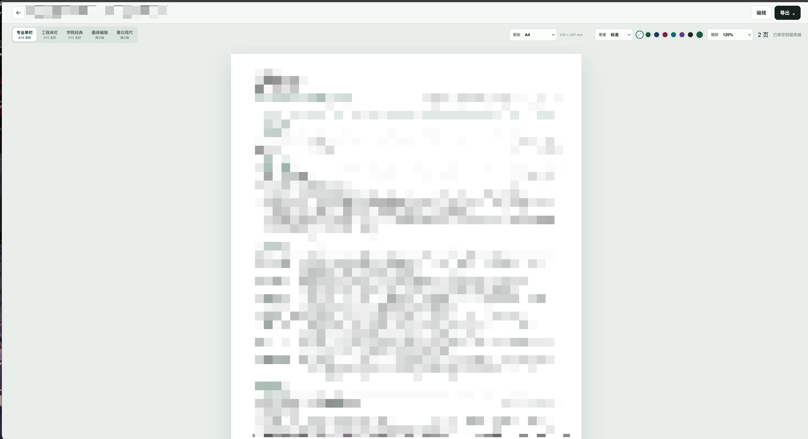

# Resume Studio

[中文](README.md) · [English](README.en.md)

A resume editor focused on content and print layout. Import Markdown or JSON, edit experience and projects, inspect real page breaks and export a document for applications. Use it entirely in the browser or self-host a personal resume library with version history.

<p align="center"></p>

## Try it online

[GitHub Pages](https://haltcatch.github.io/resume-studio/) · Local resume editing, version history and browser printing.

## Features

- Structured editing: contact details, summary, education, experience, skills and projects, with section ordering.
- Five layouts: classic, engineering, academic, editorial and gallery.
- Live pagination: A4/Letter, density, accent colors, zoom and page-break previews.
- Import/export: Markdown/JSON import, plus Markdown, JSON, HTML, plain-text and PDF export.
- Autosave and history: per-document snapshots, version restore and optimistic concurrency checks.
- Browser or server: local browser storage, or file-backed server storage without a database, with Chromium-based PDF generation.

## Quick start

Node.js 26 and pnpm 10.15.1. Server-side PDF export requires Chromium, Chrome or Edge.

```sh
npm install --global pnpm@10.15.1
pnpm install --frozen-lockfile
pnpm dev
```

## Configuration

| Setting | Purpose |
| --- | --- |
| `HOST / PORT` | Server address and port; defaults to `0.0.0.0:8787`. |
| `RESUME_DATA_DIR` | Resume storage directory; defaults to `./data/resumes`. |
| `CHROMIUM_EXECUTABLE_PATH` | Browser executable used for PDF export. |

## Usage

For development, open the URL printed by Vite. Run `pnpm build && pnpm start` for the server build. Browser-edition documents stay in that browser, with up to 50 versions; export a backup before clearing site data. Browser-edition PDF export uses the system print dialog.

## Project structure

- `src/domain/` — Resume structure, normalization and review
- `src/application/` — Editing, import/export and persistence
- `src/render/` — Layouts and themes
- `src/server/` — File storage, API and PDF

## License

[PolyForm Noncommercial 1.0.0](LICENSE). See [LICENSE_SCOPE.md](LICENSE_SCOPE.md) for the scope of original material and third-party components, and the accompanying notices for third-party copyrights and licenses.
