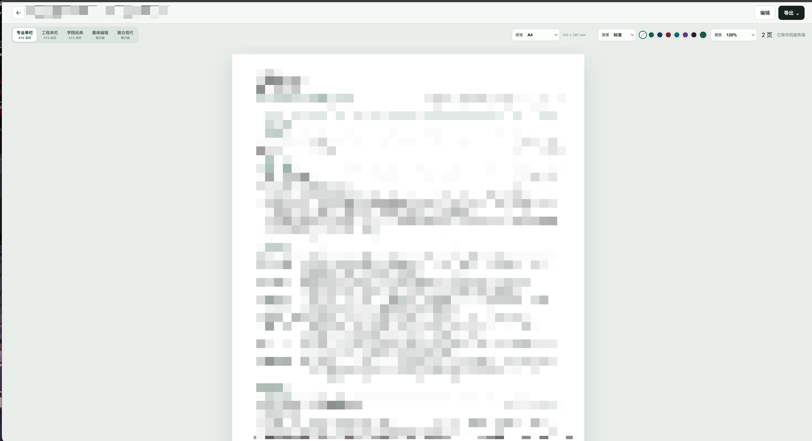

# Resume Studio

[中文](README.md) · [English](README.en.md)

专注于内容和排版的简历编辑器：导入 Markdown 或 JSON，编辑经历与项目，直接查看分页效果，再导出适合投递的文件。支持浏览器本机使用，也可自托管为带版本历史的个人简历库。

<p align="center"></p>

## 在线体验

[GitHub Pages](https://haltcatch.github.io/resume-studio/) · 本机编辑、版本历史与浏览器打印，无需服务端。

## 功能

- 结构化编辑：基本信息、个人概述、教育、工作经历、技能与项目，支持区块排序。
- 五种版式：专业单栏、工程单栏、学院经典、墨绿编辑、雅白现代。
- 实时分页：A4/Letter、排版密度、主题色、缩放与跨页预览。
- 导入导出：Markdown/JSON 导入，Markdown、JSON、HTML、纯文本与 PDF 导出。
- 自动保存与历史：按文档保存版本、查看记录并恢复；并发保存检查避免覆盖另一窗口的更新。
- 本机与自托管：浏览器版在本机保存；服务端版用文件存储，无需数据库，并通过 Chromium 生成 PDF。

## 快速开始

Node.js 26、pnpm 10.15.1。服务端 PDF 导出需要 Chromium、Chrome 或 Edge。

```sh
npm install --global pnpm@10.15.1
pnpm install --frozen-lockfile
pnpm dev
```

## 配置

| 配置项 | 说明 |
| --- | --- |
| `HOST / PORT` | 服务端监听地址和端口，默认 `0.0.0.0:8787`。 |
| `RESUME_DATA_DIR` | 简历文件目录，默认 `./data/resumes`。 |
| `CHROMIUM_EXECUTABLE_PATH` | PDF 使用的浏览器可执行文件路径。 |

## 使用

开发时打开 Vite 输出的地址。生产运行使用 `pnpm build && pnpm start`。浏览器版数据仅属于当前浏览器，最多记录 50 个版本；清除站点数据前请导出备份。浏览器版 PDF 使用系统打印对话框。

## 项目结构

- `src/domain/` — 简历结构、规范化与内容检查
- `src/application/` — 编辑、导入导出与保存
- `src/render/` — 版式与主题
- `src/server/` — 文件存储、API 与 PDF

## 许可

[PolyForm Noncommercial 1.0.0](LICENSE)。原创部分与第三方组件的适用范围见 [LICENSE_SCOPE.md](LICENSE_SCOPE.md)；各第三方版权和许可见相应声明文件。
